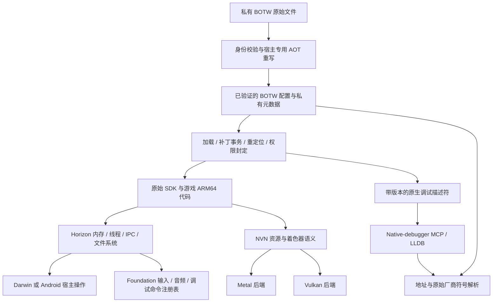

# BOTW 原生移植底座

当前唯一推进的目标是 Switch 版 BOTW **1.6.0**。保留现有 TOTK 预览版，本阶段不继续推进，也不将其用于验收。已运行的 Mac 实现提供语义和控制流参考，Android 是新增宿主。宿主调用探针通过或 APK 构建成功，都不代表游戏已经运行。

## Mac 移植实际修改了哪些部分

本次检查的源码范围：MacNativeGames 上游 `5281186`、fork 中截至 `c7fcac6` 的 Android 工作，以及本目录实现。游戏身份由现有 BOTW 源文件哈希清单和 main Build ID `8E9978D50BDD20B4C8395A106C27FFDE` 确定。是否适用必须由模块哈希判定。

| 层次 | 现有 Mac 实现证据 | 移植决策 |
| --- | --- | --- |
| ARM64 ABI | `games/totk/third_party/d2r/patch_nso.py`、`call_window.py`：x18、TLS、计时器/SVC 跳板、独占访问/调用窗口和跳转表 | 保留经过验证的 AOT 流程，为 Darwin/Bionic 分别生成代码。满足 Android 的 x18 和无 red zone 要求，禁止将 Apple 重写产物当作 Android 映像。 |
| 加载器 | `runtime/loader.c`、`scripts/prepare_runtime.py`：原始/重写哈希、符号、RELA/RELR、宿主覆盖、带保护页的宿主栈、W^X | 共用身份与模块元数据；地址预留、保护和 TLS 由宿主适配。链接前检查完整映像，不静默替换强弱导入。 |
| 初始化 | `loader.c`：原始 SDK Start、加载器回调、各模块 DT_INIT 与状态检查、原始 nnMain | 明确记录阶段转换。缺少 SVC 时标记阻塞，不能宣称初始化成功。BOTW 1.6.0 使用四参数 Start 导出。 |
| 内存 | `services.c`：39 位布局、堆/别名区预留、逻辑 4 KiB 权限、Darwin 16 KiB 页权限合并、QueryMemory | 移植 guest 内存模型。Mach API 和 Mac 地址留在宿主层，物理页大小属于宿主适配属性。 |
| 线程与同步 | `threads.c`、`gate.S`、`hle_stack.S`、`thread_enter.S`：线程句柄、TLS、独立宿主栈、等待、优先级/虚拟核、抢占 | 将 Horizon 语义与 pthread/Mach/ucontext 细节分离。先验证确定性的等待/唤醒，再接入信号抢占。 |
| 正确性补丁 | `game_patches_botw.c`：将匹配独占读写窗口中的读操作增强为 acquire；可选任务队列诊断 | 作为 Android 兼容性候选，必须针对精确输入枚举并验证并发行为。与帧率/输出修改分开管理。 |
| 功能补丁 | `game_patches_botw.c`：实时 VFR、淡入淡出/UI 时序、物理子步、按键连发、渲染/输出尺寸和宽高比 | 使用单独的显式启用配置。Android 启动基线不继承 Mac 默认值；迁移独立验收前保留 Mac 行为。 |
| 诊断 | `loader.c` 故障处理和有界帧链读取；`game_patches_botw.c` BRK 任务队列钩子；`threads.c` 等待状态转储 | 由原生 LLDB 管理停止，向其登记 guest 身份与转换证据。诊断 BRK 必须有精确来源，禁止统一忽略 SIGTRAP/SIGSEGV。 |
| 图形 | `runtime/gfx_bridge.c`、`third_party/d2r_gfx/gfx/nvn/`：NVN bootstrap 覆盖、资源、状态、着色器、提交 | 共用 NVN 语义和资源身份，Metal/Vulkan 保留各自宿主实现。不能将 Metal 对象布局直接搬到 Android。 |
| 音频、输入、文件 | `audio_mixer.c`、`input.c`、`fs_host.c`、`romfs.c` 和前端代码 | Foundation 已提供 Android 输入/音频。将 guest 协议/混音语义与宿主设备回调、生命周期分离，保留私有存档及已验证 RomFS 输入。 |

本次重新生成的 Mac BOTW 探针通过了现有指令保护检查，记录到正文中 18,249 处、重写区中 63 处 acquire 升级。这仅是精确 Mac 输入的观测结果，**不能作为 Android 补丁清单或并发正确性证明**。探针也执行了现有 Mac 功能补丁，其输出不能用于 Android 基线或性能比较。部分上游注释引用了本检出中不存在的 `botw.md`，本次未将该引用视为额外证据。

## 架构与归属



`porting/runtime` 是本 fork 内的小型跨宿主库，目前包含补丁预检和调试元数据发布 ABI。它不承担模拟器内核、CPU 解释器、调试服务器或在线服务职责。图中其余部分描述迁移边界，并不表示已经完成统一。先由 BOTW 验证接口，再考虑将确实通用的设施迁入 Foundation；游戏专用偏移不进入 Foundation。

当前 Foundation 有输入/音频和 `DebugCommandRegistry` / `DumpsysBridge`，尚无原生移植 guest patch 模块。后续 `port_status`、`port_modules` 及有界诊断请求应复用该注册表，将工作投递给运行时所有者后及时返回。不要另建 TCP 控制服务，也不要让 Android 主线程/dumpsys 线程等待 guest 启动。只读 LLDB 描述符不依赖命令传输。

## Guest patch 约定

逐游戏清单位于 [BOTW guest patch 目录](../games/botw/guest_patches/README.md)。12 项条目涵盖代码补丁、状态钩子和宿主策略，记录精确源身份、依赖/冲突关系及独立 Android 验收要求。该清单不是可执行补丁，待验证条目不会被自动启用。

必要的 AOT ABI 重写仍由现有生成器负责。小型兼容性、功能和诊断指令补丁分别分类。首版公共实现 `apply_staged` 遵循以下约定：

1. 只接收重定位、W^X 权限封定和 guest 执行之前的私有可写暂存数据；不改变页权限，不修改运行中的代码。
2. 要求提供配置、宿主 ABI、模块名、原始 NSO Build ID/源 SHA-256 和重写映像 SHA-256，并计算完整映像的实际摘要。Build ID 仅规范化末尾零**字节**，不接受任意前缀匹配。
3. 只启用显式选中的补丁 ID。功能和诊断类别还需要额外授权开关；缺少原字节保护、理由或证据即失败。
4. 首次写入前检查全部身份、字节、范围、对齐、重复 ID 和重叠。最后一个补丁失败也不能让前面的补丁部分生效。提交前分配完整结果和应用记录。
5. 返回完整可执行文件身份、输入/输出摘要，以及各补丁的 ID、类别、模块偏移、大小、字节摘要、理由与来源。游戏字节保留在私有目录。

目前尚未将 BOTW 游戏补丁迁入该引擎。Mac 加载器仍使用现有的重定位后补丁代码，调试快照会明确指出逐补丁应用记录不可用。迁移时必须分离依赖基址的修正与静态补丁，针对精确 NSO 核对原指令，处理重写窗口重叠，并在改变默认值前比较结果。不能将重定位后的映像摘要当作固定的重写映像摘要。启用任意私有补丁仍需重新生成并审查运行时配置中的固定身份；没有增加绕过哈希校验的路径。

## 原生调试器约定

复用现有 native-debugger MCP 管理宿主启动/附加、原生断点、寄存器、内存、单步、信号策略和证据。匿名 AOT 映射不是普通 ELF/Mach-O 映像，宿主 ELF Build ID/Mach-O UUID 也不是游戏 NSO Build ID。原生执行不需要增加模拟器 RSP 端点。

显式诊断 BOTW 时设置 `MNG_PORT_DEBUG=1`。两端 BOTW 加载器发布相同的宿主 C ABI：

- `mng_port_debug_descriptor`：ABI/版本/大小、偶数发布序号、加载代次、数据地址和有界长度。Android 映射/TLS key 销毁前清除描述符，其他所有者不能替换它。
- `mng_port_debug_checkpoint`：发布后的稳定函数断点。正常执行时不触发 SIGTRAP，也不等待调试器。
- JSON 数据：进程 ID、配置、宿主 ABI、阶段、清单 SHA-256，以及各模块的原始/重写身份和映射范围。Android 启动还记录线程 ID、guest 栈/TLS/TLR 和虚拟 x18 槽位。真实 x18 仍属于 Android 宿主平台，不能将其报告为 guest x18。

在 native-debugger 的同一次全线程停止中，先读描述符，再分块读取有界数据，最后重读描述符。要求 ABI 1、大小 40，两次序号/代次/指针/长度完全相同，序号为偶数、代次非零且仍有效。如果停在发布过程内部，应拒绝该快照，不能通过调用目标辅助函数或获取目标锁来补救。快照必须保留调试会话、精确 target token 和 stop epoch；跨重启时仅有 PID、地址或代次不足以证明身份。禁止仅为读取元数据而调用目标函数。

`tools/native_symbols.py` 将快照绑定到精确私有清单。先解析原始代码位置或**精确**跳板返回点，再解析原始厂商函数符号。原始正文位置可能已被改写为分支；缺少来源映射的重写区内部 PC 保持 `unknown`，不猜测最近跳板或符号。输出属于历史解析结果，修改断点前仍须重新验证实时目标和停止状态。完整重写窗口映射、混合栈回溯、挂起 guest 寄存器重建、线程/服务等待图以及 native-debugger provider 适配均**待完成**。

私有离线调查可额外设置 `MNG_PORT_DEBUG_LOG=1`，在发布点输出同样有界的 JSON 快照。阶段日志不能代替实时调试会话的控制权证明。日志含地址和身份，不含密钥或游戏指令字节，应保留在 Git 之外。

Mac 的 `port-debug-manifest.json` 由 `games/totk/scripts/prepare_runtime.py` 生成，放在现有私有运行时表旁。Android 继续使用已固定身份的 `manifest.json`，打包机制保持不变。

## 仅针对 BOTW 的里程碑

| 顺序 | 验收边界 | 所需证据 |
| --- | --- | --- |
| 0（本次） | 模块身份、补丁事务、公共调试 ABI | 宿主/设备核心测试；Mac/Android 原始 BOTW 调用；调试器全停读取；拒绝错误身份、重叠和过期代次 |
| 1 | Guest 内存与启动 | 低地址/堆/别名区预留，逻辑页与宿主页区分，内存记账，不覆盖宿主映射；GetInfo 与 QueryMemory 一致；原始 Start 到达加载器回调 |
| 2 | 线程与同步 | Guest/宿主栈所有权、TLS/x18、等待/事件/仲裁、取消与销毁；多线程失败路径测试和 BOTW 任务队列验证 |
| 3 | SDK 初始化与服务 | 确认每个 DT_INIT，进入原始 nnMain；真实 IPC 响应、RomFS 与私有存档所有权；未知服务不能伪造成功 |
| 4 | 首个正确 Vulkan 帧 | NVN 资源/描述符/同步、BOTW 专用离线 SPIR-V 与反射；保留版本和场景证据后与 Mac 实际游戏比较 |
| 5 | 性能与扩展 | 保持正确性，测量冷/热着色器及管线开销；再考虑 TOTK 等其他游戏 |

BOTW 已通过启动阶段的内存查询和首个 loader 回调，目前停于 `ConnectToNamedPort`（服务管理器 IPC）。共享内存服务和首批 NVN→Vulkan 接口已落地，详见 [Vulkan 接入说明](nvn_vulkan/README.md)。下一步仍先闭合里程碑 1 的线程/IPC/构造函数链，再连接 guest NVN 调用桥；合成 GPU 测试不代表里程碑 4 的游戏画面已经完成。即使着色器翻译离线完成，Vulkan 管线缓存仍依赖设备和驱动。不能移入 D2R 游戏着色器数据，也不能复用 Mac 帧率作为 Android 结果。

## 构建与检查

```sh
cmake -S porting -B /private/build-porting -DCMAKE_BUILD_TYPE=Debug
cmake --build /private/build-porting
ctest --test-dir /private/build-porting --output-on-failure
python3 -m unittest discover -s tests
```

Android CMake 将同一核心链接到运行时和探针。Mac 的 `runtime-botw160` 目标也构建并链接该核心；其他 Mac 游戏目标和 iOS 不启用新增调试适配器。BOTW APK 使用 `:app:assembleBotwDebug`，不要通过 `assembleDebug` 同时构建两个游戏。本阶段实际测试与限制见 [验证记录](VALIDATION.md)。
