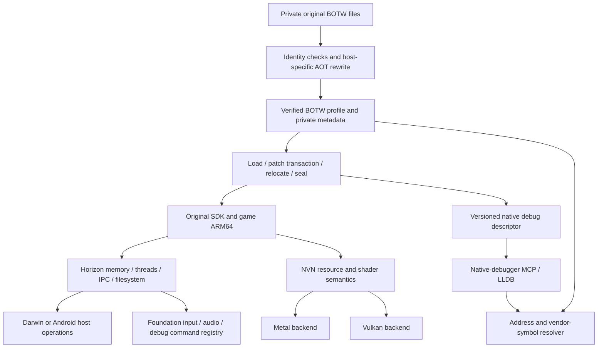

# BOTW native port foundation

BOTW Switch **1.6.0** is the only active porting target. TOTK's existing preview
is retained, but is not advanced or used to accept this work. The working Mac
implementation is the semantic/control-flow reference; Android is the new host.
Neither a host call probe nor a successful APK build establishes gameplay.

## What the Mac port actually changes

Inspected source: MacNativeGames upstream `5281186`, fork Android work through
`c7fcac6`, plus the implementation in this directory. Original game identity is
the existing BOTW source-hash manifest and main Build ID
`8E9978D50BDD20B4C8395A106C27FFDE`. Module hashes, not repository names, gate use.

| Layer | Existing Mac evidence | Porting decision |
| --- | --- | --- |
| ARM64 ABI | `games/totk/third_party/d2r/patch_nso.py`, `call_window.py`: x18, TLS, timer/SVC gates, exclusive/call windows and jump tables | Keep one verified AOT pipeline with separate Darwin/Bionic emitters. Preserve Android's x18 and no-red-zone requirements. Never reuse an Apple rewrite as an Android image. |
| Loader | `runtime/loader.c`, `scripts/prepare_runtime.py`: source/rewrite hashes, symbols, RELA/RELR, host overrides, guarded host stacks, W^X | Common identity and module metadata; host-specific reservation/protection and TLS. Check the whole image before linking. No silent weak/strong import substitution. |
| Initialization | `loader.c`: original SDK Start, loader callback, each module's DT_INIT and state check, original nnMain | Explicit stage transitions; a missing SVC is a blocked stage, not successful initialization. BOTW 1.6.0 uses the four-argument Start export. |
| Memory | `services.c`: 39-bit layout, heap/alias reservations, logical 4 KiB permissions, Darwin 16 KiB protection unions, QueryMemory | Port a guest memory model, not Mach APIs or literal Mac addresses. Physical host page size is a host adapter property. |
| Threads/synchronization | `threads.c`, `gate.S`, `hle_stack.S`, `thread_enter.S`: thread handles, TLS, private host stacks, waits, priorities/virtual cores, preemption | Separate Horizon semantics from pthread/Mach/ucontext details. Start with deterministic wait/wake tests; signal preemption is a later capability. |
| Correctness patch | `game_patches_botw.c`: strengthen matching exclusive load/store windows to acquire loads; optional job-queue diagnostics | A concrete compatibility candidate for Android, requiring exact-input enumeration plus concurrency validation. Do not mix it with FPS/output changes. |
| Feature patches | `game_patches_botw.c`: real-time VFR, fade/UI timing, physics substeps, pad repeat, render/output size and aspect | Separate opt-in profile. Android boot baseline does not inherit Mac's defaults. Mac's existing behavior is preserved until migration has independent acceptance. |
| Diagnostics | `loader.c` fault handling and bounded frame-chain reads; `game_patches_botw.c` BRK job-queue hooks; `threads.c` wait-state dumps | Native LLDB owns stops. Register guest identities and translation evidence with it. Diagnostic BRKs require exact provenance; no blanket SIGTRAP/SIGSEGV ignore policy. |
| Graphics | `runtime/gfx_bridge.c`, `third_party/d2r_gfx/gfx/nvn/`: NVN bootstrap override, resources, state, shaders, submission | Share NVN semantics and resource identities; retain separate Metal/Vulkan host implementations. Do not port Metal object layouts into Android. |
| Audio/input/files | `audio_mixer.c`, `input.c`, `fs_host.c`, `romfs.c` and frontend code | Foundation already provides Android input/audio. Keep guest protocol/mixer semantics distinct from host device callbacks and lifecycle. Preserve private saves and verified RomFS inputs. |

The regenerated Mac BOTW probe in this work verified the existing instruction
guards and reported 18,249 acquire upgrades in text and 63 in rewrite code. That
is an observed inventory for this exact Mac input, **not** an Android patch list,
and not proof of Android concurrency correctness. Existing Mac feature patches
also ran in this probe; their output is not an Android baseline or performance
measurement. Some upstream comments refer to `botw.md`, which is absent from this
checkout; those references were not treated as additional evidence.

## Architecture and ownership



`porting/runtime` is a small host-neutral library in this fork. It is not a new
emulator kernel, CPU interpreter, debug server or online service. It currently
contains patch preflight and the debugger publication ABI. The rest of the
diagram is a migration boundary, not a claim that those systems are unified.
Keep it local until BOTW proves the interfaces; only then consider promoting
truly shared facilities to Foundation. Do not move title offsets into Foundation.

The current Foundation checkout has input/audio and `DebugCommandRegistry` /
`DumpsysBridge`, but no native-port guest-patch module. Future `port_status`,
`port_modules`, and bounded diagnostic requests should use that command registry,
enqueue work to the runtime owner and return promptly. Do not create another TCP
control server or block Android's main/dumpsys thread on guest startup. The
read-only LLDB descriptor does not require a command transport.

## Guest patch contract

The title-owned inventory is [BOTW guest patches](../games/botw/guest_patches/README.md).
Its 12 entries include code patches, state hooks and host policies, with exact
source identity, dependency/conflict relationships and separate Android acceptance.
The catalog is not executable recipes; no pending entry is silently enabled.

Required AOT ABI rewrites remain in the existing generator. Small compatibility,
feature and diagnostic instruction patches use distinct categories. For the
first shared implementation, `apply_staged`:

1. Accepts private writable staging bytes, before relocation, W^X sealing and
   guest execution. It never changes page permissions or patches live code.
2. Requires profile, host ABI, module name, original NSO Build ID/source SHA-256
   and rewritten-image SHA-256. It computes the actual complete image digest.
   Build IDs normalize only trailing zero **bytes**, not arbitrary prefixes.
3. Enables only explicitly selected patch IDs. Features and diagnostics need an
   additional category opt-in. A missing byte guard, reason or evidence fails.
4. Checks all identities, bytes, extents, alignment, duplicate IDs and overlap
   before writing anything. An error in the final patch cannot leave earlier
   patches applied. It allocates the complete result/receipt before committing.
5. Returns the full executable identity, input/output digests and each patch's ID, kind, module offset, size,
   byte digests and rationale/provenance. Game bytes remain private.

No BOTW gameplay patch has been moved into this engine yet. The Mac loader still
uses its existing post-relocation patch code, and its debug snapshot explicitly
reports that per-patch receipts are unavailable. Migrating those recipes must
separate base-dependent fixups from static patches, verify original instructions
against the exact NSO, account for rewrite-window overlap, and compare outputs
before changing defaults. Do not hash a relocated image as if it were the pinned
rewrite image. Enabling arbitrary private patches still requires regenerating
and reviewing the runtime profile pins; no hash bypass was added.

## Native debugger contract

Use the existing native-debugger MCP for host launch/attach, native breakpoints,
registers, memory, stepping, signal policy and evidence. Anonymous AOT mappings
are not ordinary ELF/Mach-O images, and the host ELF Build ID/Mach-O UUID is not
the game's NSO Build ID. No emulator RSP endpoint is needed for native execution.

Set `MNG_PORT_DEBUG=1` for an explicit BOTW diagnostic run. Both BOTW loaders now
publish the same host C ABI:

- `mng_port_debug_descriptor`: ABI/version/size, even publication sequence,
  load generation, payload address and bounded length. Unload clears it before
  Android mappings/TLS keys are destroyed; another owner cannot replace it.
- `mng_port_debug_checkpoint`: a stable function breakpoint after publication.
  It neither raises SIGTRAP nor waits for a debugger during ordinary execution.
- JSON payload: process ID, profile, host ABI, phase, manifest SHA-256 and each
  loaded module's source/rewrite identity and mapped range. Android startup also
  records its thread ID, guest stack/TLS/TLR and virtual x18 slot. Android's real
  x18 remains a host platform register; it must not be reported as guest x18.

At an all-threads-stopped native-debugger epoch, read the descriptor, then its
payload (in bounded chunks), then the descriptor again. Require ABI 1, size 40,
the same even sequence/generation/pointer/length and a live nonzero generation.
Reject a stop inside publication rather than calling a target helper or taking
a target lock. Retain the native debugger session, exact target token and stop
epoch alongside the snapshot. A PID, address or generation alone is insufficient
across restarts. Never evaluate a target function just to fetch metadata.

`tools/native_symbols.py` binds the captured snapshot to its exact private
manifest. It resolves original-text locations and **exact** gate-return sites,
then original vendor function symbols. A rewritten text location may contain a
branch, and an interior rewrite PC without a source map stays `unknown`; no
nearest-gate/nearest-symbol guess is made. It emits historical results requiring
live target/stop revalidation before breakpoint changes. Full rewrite-window
source maps, mixed stack unwinding, suspended guest-register reconstruction,
thread/service wait graphs and a native-debugger provider adapter are **pending**.

For private offline investigation, additionally set `MNG_PORT_DEBUG_LOG=1` to
emit the same bounded JSON snapshots at publication points. These stage logs do
not confer live debugger ownership. They contain addresses/identities, not keys
or game instruction bytes. Keep them outside Git.

The Mac manifest is generated by `games/totk/scripts/prepare_runtime.py` next to
the existing private runtime tables as `port-debug-manifest.json`. Android uses
its existing pinned `manifest.json`; packaging was not replaced.

## BOTW-only milestones

| Order | Next acceptance boundary | Evidence required |
| --- | --- | --- |
| 0 (this change) | Module identity, patch transaction, shared debug ABI | Host/device core tests; original BOTW calls on Mac/Android; debugger all-stop read; wrong identity/overlap/stale-generation rejection |
| 1 | Guest memory and startup | Reserved low VA/heap/alias ranges, logical pages vs host pages, accounting, no clobbering host maps; GetInfo and QueryMemory agree; original Start reaches its loader callback |
| 2 | Threads and synchronization | Guest/host stack ownership, TLS/x18, waits/events/arbitration, cancellation and teardown; multi-thread negative tests and BOTW job-queue validation |
| 3 | SDK initialization and services | Every DT_INIT confirmed, original nnMain reached; real IPC responses, RomFS and private save ownership; no successful unknown-service stubs |
| 4 | First correct Vulkan frame | NVN resources/descriptors/sync, BOTW-specific offline SPIR-V and reflection; compare actual gameplay against Mac with version/scene evidence |
| 5 | Performance and expansion | Correctness retained, cold/warm shader and pipeline costs measured; then consider another title such as TOTK |

BOTW currently stops at `GetInfo(AslrRegionAddress)` after its entropy requests.
The next implementation is milestone 1, using the debugger/identity facilities
above. A Vulkan pipeline cache remains device/driver dependent even when shader
translation is offline. Do not import D2R shader data or reuse Mac FPS figures.

## Building and checks

```sh
cmake -S porting -B /private/build-porting -DCMAKE_BUILD_TYPE=Debug
cmake --build /private/build-porting
ctest --test-dir /private/build-porting --output-on-failure
python3 -m unittest discover -s tests
```

Android CMake links the same core into the runtime/probes. The Mac
`runtime-botw160` target builds/links it; other Mac title targets and iOS do not
enable the debugger adapter. Build the BOTW APK with `:app:assembleBotwDebug`,
not `assembleDebug` for both titles. See [VALIDATION.md](VALIDATION.md) for the
actual tests and limits of this checkpoint.
